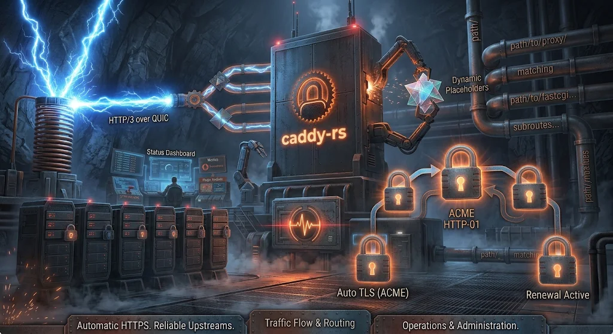
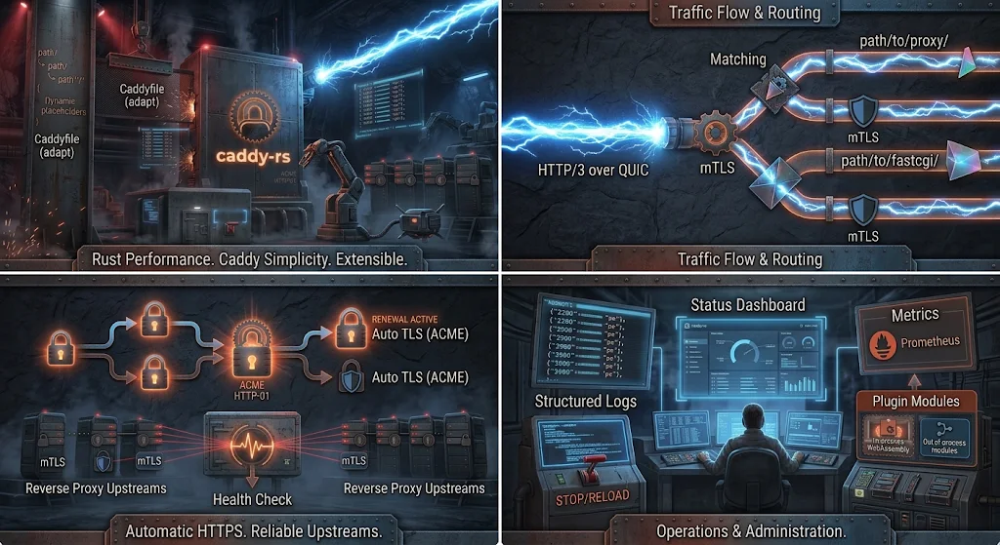

<div align="center">

# caddy-rs



**A Caddy-compatible web server, reverse proxy and TLS automation engine, written in Rust.**

Same configuration language. Same operational model. Your Caddyfile either behaves as it does on
Caddy, or fails at load with an error naming the construct.

[](LICENSE)


</div>

---

## What this is

caddy-rs is an independent Rust implementation of the Caddy v2 configuration and runtime model. It
reads the same **Caddyfile** and **JSON** configurations, serves the same protocols, performs the
same automatic HTTPS flow, and exposes the same admin API — so a deployment that works on Caddy can
be moved over without rewriting its configuration.

Where behaviour deliberately differs, the difference is a documented, tested boundary rather than a
silent surprise: unsupported configuration fails at load with a located error that names the field.

> **Independent project.** caddy-rs is not affiliated with, sponsored by, or endorsed by the Caddy
> project, its maintainers or its trademark holders. Caddy is a registered trademark of its
> respective owner. See [NOTICE.md](NOTICE.md).

## Quick start

```sh
git clone https://github.com/ben-efros/caddy-rs
cd caddy-rs
cargo build --release

cat > Caddyfile <<'CF'
example.com {
	root * /srv
	encode gzip zstd
	file_server
}
CF

./target/release/caddy-rs validate --config ./Caddyfile --adapter caddyfile
./target/release/caddy-rs run      --config ./Caddyfile --adapter caddyfile
```

That configuration serves static files over HTTPS with a certificate obtained automatically, gzip
and zstd compression negotiated per request, and HTTP/3 on the same address whenever the client
supports it.


## Highlights

| Area | What you get |
|---|---|
| **Protocols** | HTTP/1.1, HTTP/2, h2c (prior knowledge and upgrade), and HTTP/3 over QUIC — UDP listeners are derived from TLS addresses and advertised with `Alt-Svc`, no extra configuration |
| **Automatic HTTPS** | Certificates from ACME (HTTP-01, TLS-ALPN-01, DNS-01) or the built-in internal CA, with renewal and hot-swap that never drops a connection |
| **Reverse proxy** | Every Caddy load-balancing policy, retries, active and passive health checks, dynamic upstreams, upstream TLS with mTLS, FastCGI, and PROXY protocol in both directions |
| **Routing** | The full route model — matchers, subroutes, groups, named routes, error routes — plus a placeholder engine used consistently across handlers |
| **Responses** | Streaming bodies end to end, compression, range and conditional requests, precompressed sidecars, and Go-compatible file serving |
| **Operations** | Structured access logs with credential redaction and rotation, Prometheus metrics, and an admin API for live configuration changes |
| **Extensibility** | Third-party modules load at runtime as sandboxed WebAssembly or as separate processes — no rebuild of the server required |

The complete, verified list lives in **[docs/FEATURES.md](docs/FEATURES.md)**.

## Configuration

caddy-rs accepts two forms, and converts between them:

- a **Caddyfile** — the human-friendly format Caddy is known for (`caddy-rs adapt` shows the JSON),
- **native JSON** — the same shape Caddy accepts, including `apps.http`, `apps.tls`, `admin` and
  `logging`.

```sh
# what does this Caddyfile mean as JSON?
caddy-rs adapt --config ./Caddyfile --adapter caddyfile --pretty

# check a configuration without starting the server
caddy-rs validate --config ./caddy.json --adapter json
```

Caddyfile and JSON semantics are documented upstream by the Caddy project
(<https://caddyserver.com/docs/>); the surface this build supports is listed in
[docs/FEATURES.md](docs/FEATURES.md), and the configuration model is introduced in
[docs/CONFIGURATION.md](docs/CONFIGURATION.md).

## Command line

```sh
caddy-rs run          # start the server
caddy-rs validate     # check configuration, exit non-zero on error
caddy-rs adapt        # convert Caddyfile to JSON
caddy-rs reload       # load a new configuration through the admin API
caddy-rs stop         # stop a running server through the admin API
caddy-rs list-modules # what this build contains
caddy-rs pki          # inspect or export the local certificate authority
caddy-rs trust        # install the local CA root into host trust stores
```

Full reference: **[docs/CLI.md](docs/CLI.md)**. Installation and build options:
**[docs/INSTALL.md](docs/INSTALL.md)**.

## Plugins

Modules can be added without rebuilding the server, in two shapes:

- **In-process WebAssembly** — the host runs guest code under an enforced fuel, wall-clock and
  memory budget, with capabilities granted explicitly and denied by default.
- **Out-of-process modules** — a separate process (or an operator-provided local socket) speaking a
  versioned frame protocol; a crash fails that module's session and leaves the server running.

Start at **[docs/PLUGINS.md](docs/PLUGINS.md)**, then read the
[host ABI](docs/PLUGIN-ABI.md), the [wire protocol](docs/PLUGIN-PROTOCOL.md) or the
[module author's guide](docs/PLUGIN-DEVELOPMENT.md).

## Compatibility

Compatibility is measured, not asserted. The project compares this implementation against a real
Caddy v2.11.9 binary and against Caddy's own configuration corpus:

- **541 behavioural probes** against the reference binary, with **no mismatches**;
- **132 of 264** upstream Caddyfile fixtures adapt byte-identically, with the rest rejected at load
  rather than approximated;
- **1,928 tests** across the workspace.

Configuration this build does not support is refused with a located error, so an incompatible
configuration fails before any listener changes.

## Documentation

| Document | Contents |
|---|---|
| [Installation](docs/INSTALL.md) | requirements, building, offline builds, where state lives |
| [Command line](docs/CLI.md) | every subcommand, option and exit-code convention |
| [Features](docs/FEATURES.md) | everything the server does, by area |
| [Configuration](docs/CONFIGURATION.md) | Caddyfile vs JSON, validation, admin API |
| [Plugins](docs/PLUGINS.md) | runtime module models and how to write one |
| [Design](docs/DESIGN.md) | crate layout and runtime architecture |
| [Testing](docs/TESTING.md) | test layers and how to run them |
| [Releasing](docs/RELEASING.md) | building and publishing the platform archives |

## Status

This is a **preview release** (`0.1.0-trial.1`). It is suitable for evaluation, internal services and
deployments you can afford to debug. Before relying on it for public traffic, read the release notes
that accompany the preview and prefer certificate sources you control (pre-loaded certificates or the
internal CA) over public ACME issuance.

## License

Apache-2.0. See [LICENSE](LICENSE) and [NOTICE.md](NOTICE.md).
